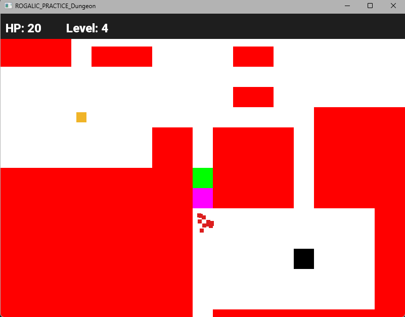

# Dungeon Escape

Roguelike с процедурным подземельем. Героя похитили, и он пытается сбежать:
уйди от ищейки, найди дверь и пройди как можно больше уровней.
Дипломный проект курса «Разработчик игр» (XYZ School), C++ и SFML 2.5.1.
Рабочее название проекта в коде — Rogalique.

## Как запустить

1. Скачай `Rogalique-v1.0-win64.zip` из [Releases](https://github.com/mishamiklaev-cpu/rogalik-diplom/releases).
2. Распакуй и запусти `Rogalique.exe`. Папка `Resources` должна лежать рядом с exe.

Нужны Windows 10/11 x64 и Microsoft Visual C++ Redistributable 2015–2022 (x64).
Обычно он уже установлен; если игра не стартует — его можно скачать с сайта Microsoft.

## Управление

| Клавиша | Действие |
|---|---|
| W A S D | движение по клеткам |
| Space | рестарт после Game Over |

## Что в игре

- **Процедурная генерация.** Каждый уровень — новые комнаты и коридоры (`Dungeon`),
  по периметру карты всегда стена.
- **Враг-ищейка.** Ищет путь к игроку волной BFS по карте расстояний и спускается
  к нему по кратчайшему пути — не застревает в углах и не ходит маятником.
  Появляется не ближе 10 клеток от игрока.
- **Здоровье.** 100 HP. Пока ищейка стоит на клетке игрока, она бьёт на 25 HP
  раз в 0.8 секунды.
- **Зелья здоровья.** +20 HP, но не выше 100. Количество растёт с уровнем:
  на уровнях 1–10 одно зелье, на 11–20 два и так далее.
- **Переход на уровень.** Встал на дверь — мир замирает на 3 секунды,
  экран ступенчато темнеет, под чёрным собирается новый уровень, затем экран светлеет.
- **Game Over.** При 0 HP экран медленно темнеет, показывается число пройденных
  уровней и подсказка рестарта.
- **HUD.** Панель сверху: HP и номер уровня, обновляются сразу. Камера рисует мир
  только под панелью.
- **Камера.** Следует за игроком и не выходит за границы карты.

## Направление диплома: Graphics Developer, средний уровень

- **Лёгкий уровень — тряска камеры.** Пока ищейка стоит на клетке игрока, камера дрожит
  на ±10 пикселей. У края карты сдвиг отражается в обратную сторону,
  чтобы не показывать черноту за картой.
- **Средний уровень — система частиц.** Класс `Particle` (позиция, скорость, время жизни),
  вспышка из 12 частиц в точке события: красные искры при ударе, зелёная вспышка
  при выпитом зелье. Частицы разлетаются и через 0.6 с исчезают: удаляются из вектора, когда кончилась жизнь.

## Сборка из исходников

Нужна Visual Studio 2022 и SFML 2.5.1 в папке `SFML/` рядом с `rogalique.sln`
(как в шаблоне курса; в репозиторий SFML не входит). SFML подключён статически,
поэтому собранному exe не нужны dll SFML.

- Конфигурации: `Debug x64` и `Release x64`.
- Из VS игра запускается по F5: рабочая папка проекта — `Rogalique/Resources`.

## История разработки

Каждая фича сделана в отдельной ветке и влита в `main` через Pull Request:

| PR | Ветка | Что сделано |
|---|---|---|
| #1 | `fix/cleanup` | чистка кода: мёртвый код, дубли проверок, стиль имён |
| #2 | `feature/take-new-lvl` | дверь-выход, переход на новый уровень с затемнением |
| #3 | `feature/camera-clamp` | камера в границах мира, стены по периметру карты |
| #4 | `feature/enemy-unstuck` | враг переписан на BFS |
| #5 | `feature/health` | HP, урон, Game Over, рестарт, HUD-панель |
| #6 | `feature/potion` | зелья здоровья |
| #7 | `feature/particles` | система частиц |
| #8 | `docs/readme` | README под текущую игру, скриншот |
| #9 | `fix/remove-dead-game` | удалён мёртвый код из прошлого задания |
| #10 | `docs/design-doc` | Design Doc |

Механики, оценка в сторипоинтах, спринты «план и факт» и бэклог — в [Design Doc](docs/design-doc.md).
